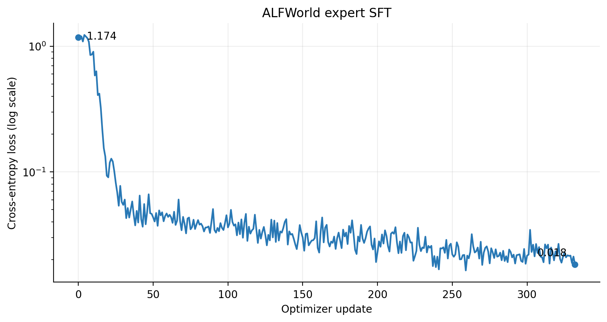
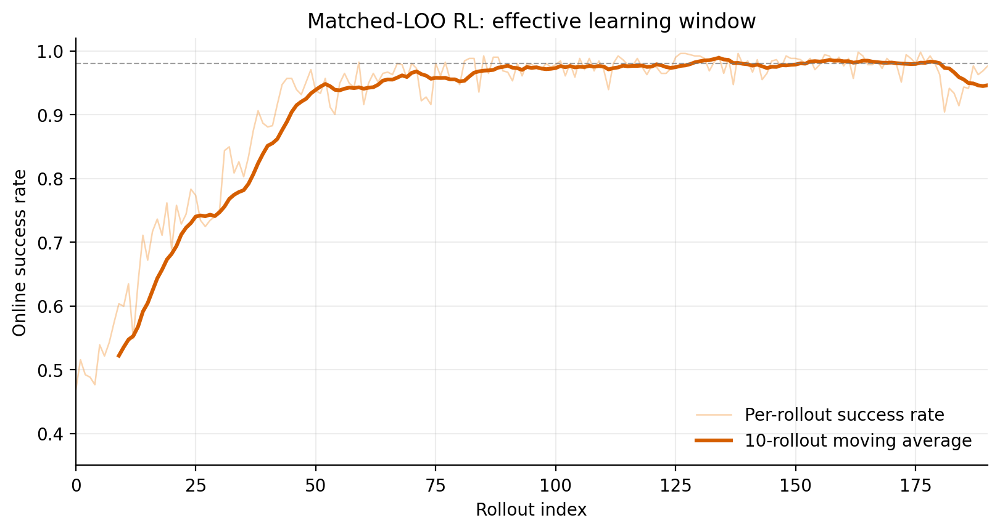

> **Updated November 4, 2026.** This post now reports the complete evaluation matrix: four RL methods, three training seeds, five evaluation conditions, 134 held-out tasks, and 32,160 RL evaluation episodes. The central result is sharper than the original single-run story: clean RL learns the task, but noise RL is required to make the policy robust. Independent-noise LOO gives the best overall trade-off, reaching **91.4% matched-noise success** and **82.5% strong-noise success**, while preserving **95.8% clean success**.

## The research question

An LLM agent is not just a set of model weights. Its behavior also depends on the harness around the model: the prompt, tool schema, action parser, environment transition, observation format, context policy, and termination rules.

One ALFWorld interaction turn in this project looks like this:

```text
The model emits one JSON action
              ↓
The harness parses and executes it in ALFWorld
              ↓
The environment returns a text observation
              ↓
The observation enters the context and the model acts again
```

This creates two distinct learning problems:

1. **Task learning:** can the agent complete ALFWorld tasks efficiently?
2. **Robustness learning:** can it still complete them when the harness drops an action or loses an observation?

The experiments below separate these questions. We first use supervised fine-tuning (SFT) to establish a usable policy, then compare clean RL with three noise-aware leave-one-out (LOO) training designs.

## Experimental setup

The base model was `Qwen3-4B-Instruct-2507`. Training used [Slime](https://github.com/THUDM/slime), the environment was [ALFWorld](https://github.com/alfworld/alfworld), and telemetry was recorded with SwanLab.

| Stage | Main configuration |
| --- | --- |
| SFT | 3,553 expert trajectories and 21,335 expert actions; action-only loss; batch size 32; three epochs; peak learning rate `5e-6`; 4×A100 80GB |
| RL | Fully asynchronous LOO/GRPO-style training; eight samples per prompt; 8×A100 80GB, split between actor training and rollout |
| Evaluation | 134 `valid_unseen` tasks × four repeats = 536 episodes per checkpoint-condition cell; temperature 0.8 |
| Replication | Four RL methods × seeds 42, 43, and 44 × five conditions = 60 cells and 32,160 RL episodes |

SFT and RL used the same JSON action representation and online environment protocol. SFT loss was applied only to assistant actions, not to system prompts or environment observations.

### Training methods

- **Clean RL:** no action or observation faults during training.
- **Matched-noise LOO:** samples compared within a group experience the same sampled fault pattern.
- **Independent-noise LOO:** each rollout samples faults independently, so the group comparison averages over harness randomness.
- **Coupled-prompt LOO:** fault coupling is organized at the prompt/group level to control common randomness while retaining noisy interaction.

### Evaluation conditions

| Condition | Faults applied at evaluation |
| --- | --- |
| Clean | No injected faults |
| Action-only | Action dropping only |
| Observation-only | Observation loss only |
| Matched | 15% action drop and 10% observation loss, matching the main training setting |
| Strong | A stronger combined-noise stress test |

The noise is injected during real multi-turn interaction, not by corrupting static labels. The agent must infer whether an action took effect, recover when information is missing, and finish within the interaction budget.

## Stage 1: expert SFT establishes a usable policy

Sparse-reward RL cannot bootstrap reliably if almost every trajectory fails. When every sample in a group receives the same reward, the relative advantages are zero and the optimizer receives no useful comparison signal.

SFT teaches three prerequisites:

1. Emit JSON actions that the harness can parse.
2. Understand ALFWorld actions and observations.
3. Reach enough initial successes for RL to compare good and bad trajectories.

The SFT run completed 333 optimizer updates. Cross-entropy loss fell from **1.174 to 0.018**, with most improvement occurring early.



Low training loss did not make the agent reliable. Under the final unified evaluation protocol, the SFT checkpoint achieved:

| Clean | Action-only | Observation-only | Matched | Strong |
| ---: | ---: | ---: | ---: | ---: |
| 51.1% | 39.7% | 48.5% | 35.8% | 30.0% |

Most failures exhausted the turn budget rather than crashing on malformed output. SFT had taught the interface and basic behavior, but not a compact or fault-tolerant policy.

## Stage 2: RL learns the task—and noise RL learns recovery

For each task, the policy generated eight rollouts and used a leave-one-out baseline to produce relative advantages. Successful action sequences received positive signal while failed trajectories for the same task acted as controls.

The training curve below is from an early exploratory matched-noise run. It remains useful as an illustration of the learning dynamics, but it is not the source of the multi-seed aggregate results reported later.



The early runs revealed two effects that later repeated across the full experiment:

- RL dramatically shortened successful policies.
- Continuing updates after saturation could destabilize and eventually collapse a strong policy.

One subtle point is that RL `train/loss` should not be read like SFT cross-entropy. Its value depends on relative advantages, importance ratios, clipping, and cancellation between positive and negative samples. Held-out success, non-zero groups, policy drift, gradient norm, and trajectory efficiency are more informative.

## Main result: the complete multi-seed evaluation

The table reports mean success ± standard deviation across three independent RL training seeds. The SFT baseline is a single trained checkpoint and therefore has no across-seed standard deviation.

| Method | Clean | Action-only | Observation-only | Matched | Strong |
| --- | ---: | ---: | ---: | ---: | ---: |
| SFT baseline | 51.12 | 39.74 | 48.51 | 35.82 | 30.04 |
| Clean RL | **97.57 ± 0.49** | 74.32 ± 2.72 | 93.22 ± 0.28 | 68.91 ± 1.55 | 48.07 ± 0.88 |
| Matched-noise LOO | 95.27 ± 0.66 | 92.91 ± 1.17 | 93.03 ± 1.32 | 88.93 ± 0.92 | **82.90 ± 0.54** |
| Independent-noise LOO | 95.77 ± 0.22 | 94.09 ± 0.47 | **94.53 ± 1.03** | **91.36 ± 0.84** | 82.52 ± 1.12 |
| Coupled-prompt LOO | 96.08 ± 0.56 | **94.59 ± 0.49** | 94.40 ± 0.81 | 90.49 ± 0.93 | 81.22 ± 0.78 |

All values are percentages. Bold marks the best RL mean in each evaluation condition.

### Result 1: clean RL learns general task completion

Relative to SFT, clean RL improved success by:

- **+46.45 points** on clean evaluation;
- **+34.58 points** with action drops;
- **+44.71 points** with observation loss;
- **+33.09 points** under matched combined noise;
- **+18.03 points** under strong noise.

So ordinary online RL is already valuable. It turns an imitation policy into a much stronger task-solving policy and transfers part of that gain to conditions it never saw during training.

### Result 2: clean competence is not robust competence

Clean RL reached 97.57% in the clean environment, but fell to 74.32% with action dropping, 68.91% under matched combined noise, and 48.07% under strong noise. Its strong-noise penalty relative to clean performance was **49.50 points**.

Observation loss alone was much less damaging: clean RL retained 93.22%. This identifies **action dropping as the dominant fault** in the current harness. Losing an observation is often recoverable from later state; silently losing a state-changing action can invalidate the agent's assumed world state.

### Result 3: noise RL closes most of the robustness gap

Compared with clean RL, independent-noise LOO changed success by:

| Clean | Action-only | Observation-only | Matched | Strong |
| ---: | ---: | ---: | ---: | ---: |
| −1.80 | **+19.78** | +1.31 | **+22.45** | **+34.45** |

This is the main research result. A small clean-performance cost buys a very large improvement under action faults and combined noise. The effect is not merely better task learning: the training distribution changes the recovery behavior learned by the agent.

### Result 4: independent-noise LOO is the best overall trade-off

| Method | Average over all five conditions | Average over four noisy conditions | Worst condition |
| --- | ---: | ---: | ---: |
| Clean RL | 76.42 | 71.13 | 48.07 |
| Matched-noise LOO | 90.61 | 89.44 | **82.90** |
| Independent-noise LOO | **91.65** | **90.62** | 82.52 |
| Coupled-prompt LOO | 91.36 | 90.17 | 81.22 |

Independent-noise LOO had the best overall and noisy-condition averages. It also beat matched-noise LOO on matched evaluation for every training seed: **+2.61, +2.05, and +2.61 points** for seeds 42, 43, and 44.

A plausible interpretation is that independently sampled faults prevent the group baseline from treating one particular fault realization as part of task identity. The policy must learn behavior that succeeds across fault realizations, rather than specialize to a shared corruption pattern. This is an inference from the experimental design and requires further ablation to establish causality.

Coupled-prompt LOO was competitive and had the best action-only mean, but it did not consistently surpass independent-noise training under matched or strong combined noise. More complicated coupling therefore did not produce a clear aggregate advantage in this setting.

## Robust policies are also more efficient

The improvement did not come from retrying more often. Independent-noise LOO used far fewer generated tokens than SFT:

| Condition | SFT tokens | Independent-noise tokens | Reduction |
| --- | ---: | ---: | ---: |
| Clean | 285.0 | 126.2 | 55.7% |
| Action-only | 355.3 | 155.9 | 56.1% |
| Observation-only | 299.7 | 140.5 | 53.1% |
| Matched | 370.9 | 174.3 | 53.0% |
| Strong | 404.6 | 233.1 | 42.4% |

Mean tool calls show the same pattern. Under matched noise, they fell from **30.6 for SFT** to **14.7 for independent-noise LOO**; under strong noise, from **33.4 to 19.9**.

The robust policy therefore learned **effective recovery**, not brute-force repetition. It usually followed a shorter path and spent extra actions only when the fault condition required them.

## The failure we should not hide: RL can still collapse

The early main run produced a strong middle checkpoint and a useless final checkpoint:

| RL checkpoint | Noisy success |
| --- | ---: |
| `iter_0000049` | 93.8% |
| `iter_0000099` | 97.6% |
| `iter_0000299` | **98.7%** |
| `iter_0000449` | **98.7%** |
| `iter_0000499` | 7.5% |
| `iter_0000699` | 0.0% |

The collapse was a training-dynamics result, not the final multi-seed performance claim. It motivated stricter checkpoint selection and safer later experiments.

Several warning signs aligned:

- Success saturation produced many equal-reward groups and very little useful gradient signal.
- Fully asynchronous rollout created a version gap between generated trajectories and current actor weights.
- With weak policy anchoring, stale negative advantages could push the policy toward shorter but invalid behavior.
- Once every rollout in a group failed, relative advantages became zero and the policy could not recover by itself.

This is why `latest` is not a valid model-selection rule for agentic RL. The final matrix evaluates deliberately selected checkpoints under a fixed protocol.

## What these experiments taught us

### The harness is part of the learning problem

Action syntax, tool schemas, fault injection, error handling, turn limits, and context truncation all change the effective MDP. Training and evaluation must use aligned harness semantics. Otherwise two runs can share the label “ALFWorld” while solving different problems.

### Online reward is not independent evaluation

Training rollouts depend on task sampling, asynchronous policy versions, and random faults. We therefore used held-out `valid_unseen` tasks, fixed sampling settings, four repeats per task, and independently launched inference services.

### Task-level bootstrap and training seeds answer different questions

Bootstrap confidence intervals quantify uncertainty over held-out tasks for one checkpoint. Replicated training seeds measure optimization variability. They are not interchangeable.

The RL results now include three training seeds, but the SFT baseline still comes from one trained checkpoint. Moreover, the small differences among the three noise-RL methods should not be described as statistically significant until we run a **paired task-level hierarchical bootstrap** that preserves both task pairing and seed structure.

### Stopping criteria must be behavioral

For sparse-reward agentic RL, stop or reduce the learning rate when held-out success plateaus, effective groups disappear, policy drift rises, or trajectory behavior changes abruptly. Checkpoint every fixed interval and select using clean plus noisy held-out evaluation.

## Updated conclusions

The full experiment supports a three-stage account of agent learning:

1. **SFT teaches the interface and provides initial successful behavior.**
2. **Clean RL teaches efficient task completion.**
3. **Noise RL teaches robust task completion under an unreliable harness.**

The strongest practical configuration in this study is independent-noise LOO. It retained **95.8% clean success**, achieved **91.4% under matched noise**, and remained above **82% under strong noise**, while using roughly half as many generated tokens as the SFT policy.

The broader lesson is that robustness does not automatically emerge from high clean-task reward. If deployed agents will face dropped actions, missing observations, flaky tools, or ambiguous execution feedback, those failure modes must be represented in the online learning problem—and evaluated independently from ordinary task competence.

## Remaining experiments

Before treating the result as a finished paper claim, the next priorities are:

1. Run a paired hierarchical bootstrap for direct method-to-method comparisons.
2. Train additional SFT seeds, or clearly retain SFT as a fixed initialization baseline.
3. Sweep action-drop and observation-loss rates to estimate robustness curves rather than only five operating points.
4. Ablate group construction while holding the marginal noise distribution fixed.
5. Evaluate transfer to different noise rates, unseen fault types, and at least one additional agent environment.
6. Report compute and wall-clock efficiency alongside success and trajectory length.

## Experiment links

- [SwanLab project overview](https://swanlab.cn/@mousewu/agentic-noise-rl/v1/geh96f/overview)
- [SFT training curves](https://swanlab.cn/@mousewu/agentic-noise-rl/v1/geh96f/runs/77110e675af74354bd5d4b08bae801ed/chart)
- [Early RL exploration run](https://swanlab.cn/@mousewu/agentic-noise-rl/v1/geh96f/runs/1af53b5369cb4bd355d4a727942/chart)
- [Project source code](https://github.com/mousewu/slime-noise-rl)

> **Scope note:** These results use a project-specific ALFWorld text harness, fault injection, checkpoint-selection procedure, and evaluation protocol. They are not standard ALFWorld leaderboard numbers. RL values are means over three training seeds; the SFT baseline is one trained checkpoint. Differences among noise-RL variants require paired hierarchical analysis before being treated as statistically significant.
