

Terminal-RSI studies how a terminal agent can improve recursively through execution, trajectory rewriting, critic calibration, and reinforcement learning. This article follows my 20-minute technical talk slide by slide. The slides retain their original Chinese text; the English captions explain the role of each page.

The presentation is based on the Terminal-RSI work by Junyao Yang and collaborators. See the [paper](https://arxiv.org/abs/2610.22192) and [project page](https://yyang26.github.io/terminal-rsi/) for the original research.

Terminal-RSI 研究终端智能体如何通过执行、轨迹改写、Critic 校准和强化学习进行递归改进。本文按照我的 20 分钟技术分享逐页展开，完整保留 14 页幻灯片，并补充每一页在整体方法中的作用。

这份分享基于 Junyao Yang 等人的 Terminal-RSI 工作。原始研究可参阅[论文](https://arxiv.org/abs/2610.22192)和[项目主页](https://yyang26.github.io/terminal-rsi/)。

<h2>1. The problem Terminal-RSI addresses1. Terminal-RSI 要解决的问题</h2>

Terminal agents do not answer once and stop. They inspect repositories, edit files, execute commands, observe long logs, and rely on a verifier to determine whether the final state is correct. Terminal-RSI asks how this loop can improve itself across generations.终端智能体不是完成一次问答后就结束。它需要检查代码仓库、修改文件、执行命令、读取长日志，并依赖 verifier 判断最终状态是否正确。Terminal-RSI 关注的是：这个交互闭环如何跨代自我改进。

<figure class="slide-figure">
  <a href="/assets/blog/terminal-rsi/slide-01-terminal-rsi.jpg" target="_blank" rel="noopener">
    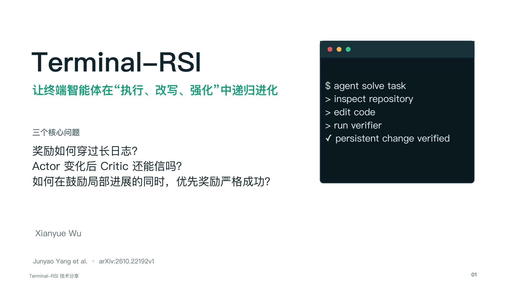
  </a>
  <figcaption>Slide 1 · Terminal-RSI improves terminal agents through execution, rewriting, and reinforcement. The talk centers on delayed credit, critic validity after policy change, and the priority of strict task completion.第 1 页 · Terminal-RSI 让终端智能体在执行、改写和强化中递归进化。三个核心问题是长日志下的信用分配、Actor 变化后的 Critic 可信度，以及严格成功相对局部进展的优先级。</figcaption>
</figure>

<figure class="slide-figure">
  <a href="/assets/blog/terminal-rsi/slide-02-agenda.jpg" target="_blank" rel="noopener">
    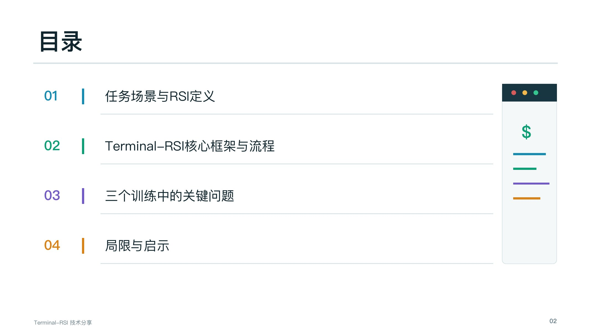
  </a>
  <figcaption>Slide 2 · The talk moves from the task setting and RSI definition to the full pipeline, three training problems, and the method's limitations.第 2 页 · 分享依次介绍任务场景与 RSI 定义、Terminal-RSI 核心流程、三个训练问题，以及方法的局限与启示。</figcaption>
</figure>

<h2>2. Terminal agents and recursive improvement2. 终端智能体与递归改进</h2>

A terminal task is a sequence of short model decisions separated by potentially long observations. The final reward may arrive only after many actions. This makes the environment trajectory, harness, and verifier part of the learning problem rather than mere implementation details.终端任务由一系列短模型决策组成，中间夹着可能很长的环境观察，而最终奖励往往在多个动作之后才出现。因此，环境轨迹、harness 和 verifier 都是学习问题的一部分，而不是单纯的实现细节。

<figure class="slide-figure">
  <a href="/assets/blog/terminal-rsi/slide-03-terminal-agent-loop.jpg" target="_blank" rel="noopener">
    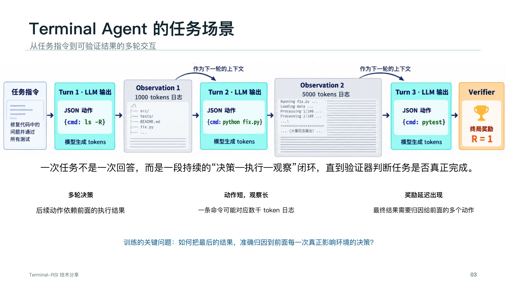
  </a>
  <figcaption>Slide 3 · One task is a continuing decision–execution–observation loop. Actions are short, observations can contain thousands of tokens, and the verifier supplies a delayed terminal reward.第 3 页 · 一次任务是一段持续的“决策—执行—观察”闭环。动作很短，观察可能包含数千 token，最终由 verifier 提供延迟的终局奖励。</figcaption>
</figure>

<figure class="slide-figure">
  <a href="/assets/blog/terminal-rsi/slide-04-rsi-optimization-objects.jpg" target="_blank" rel="noopener">
    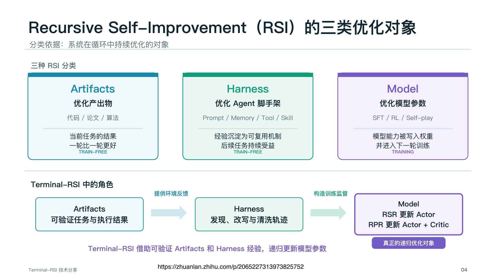
  </a>
  <figcaption>Slide 4 · Recursive self-improvement can optimize artifacts, the agent harness, or model parameters. Terminal-RSI uses verified artifacts and harness experience to drive recursive model updates.第 4 页 · 递归自我改进可以优化 Artifacts、Harness 或 Model。Terminal-RSI 利用可验证的产出物和 harness 经验，递归更新模型参数。</figcaption>
</figure>

<h2>3. The complete Terminal-RSI cycle3. Terminal-RSI 的完整循环</h2>

The system alternates between two update stages. Recursive Self-Rewrite first converts successful but harness-specific trajectories into reusable demonstrations. Recursive Policy-Refine then explores online and updates the actor–critic policy. A calibrated critic is carried into the next cycle.整个系统在两个更新阶段之间交替。Recursive Self-Rewrite 先把成功但依赖特定 harness 的轨迹改写成可复用示范；Recursive Policy-Refine 再进行在线探索并更新 Actor–Critic 策略。经过校准的 Critic 会被带入下一轮循环。

<figure class="slide-figure">
  <a href="/assets/blog/terminal-rsi/slide-05-terminal-rsi-flow.jpg" target="_blank" rel="noopener">
    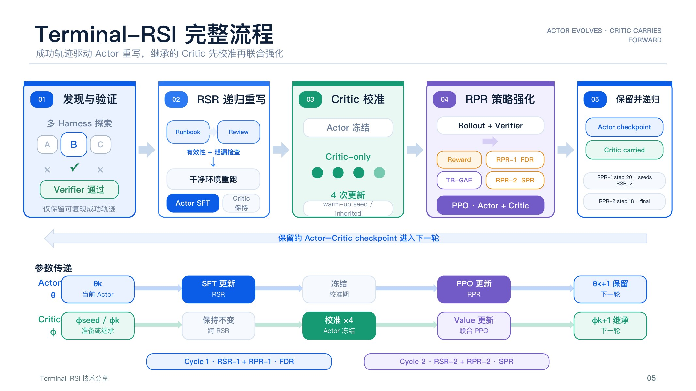
  </a>
  <figcaption>Slide 5 · The five stages are discovery and verification, recursive rewriting, critic calibration, policy refinement, and checkpoint retention. Actor and critic parameters follow different update paths.第 5 页 · 五个阶段分别是发现与验证、递归改写、Critic 校准、策略强化，以及 checkpoint 保留。Actor 与 Critic 采用不同的参数更新路径。</figcaption>
</figure>

<h2>4. Recursive Self-Rewrite and Policy-Refine4. Recursive Self-Rewrite 与 Policy-Refine</h2>

The two stages solve different problems. RSR removes accidental dependencies on the source harness and expands the supply of training trajectories. RPR continues exploration under the updated policy and turns verifier feedback into actor–critic updates.两个阶段解决不同问题。RSR 去除轨迹对源 harness 的偶然依赖，并扩充训练轨迹；RPR 使用更新后的策略继续探索，把 verifier 反馈转化为 Actor–Critic 更新。

<figure class="slide-figure">
  <a href="/assets/blog/terminal-rsi/slide-06-recursive-self-rewrite.jpg" target="_blank" rel="noopener">
    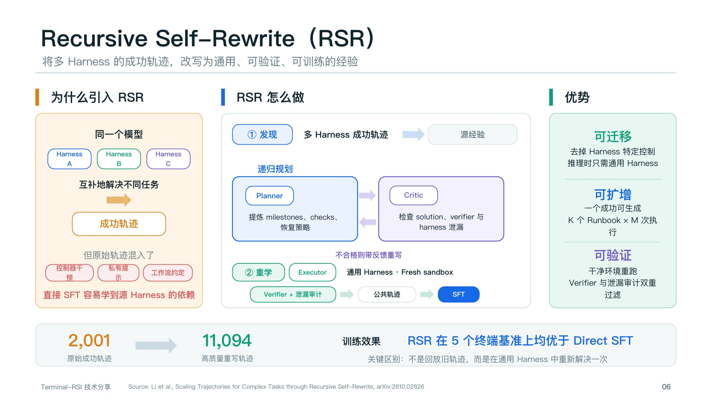
  </a>
  <figcaption>Slide 6 · RSR discovers successful trajectories from multiple harnesses, plans a general solution, rewrites it in a fresh sandbox, and keeps only examples that pass both the verifier and leakage audit.第 6 页 · RSR 从多个 harness 中发现成功轨迹，规划通用解法，在干净 sandbox 中重新执行，并只保留同时通过 verifier 和泄漏审计的样本。</figcaption>
</figure>

<figure class="slide-figure">
  <a href="/assets/blog/terminal-rsi/slide-07-recursive-policy-refine.jpg" target="_blank" rel="noopener">
    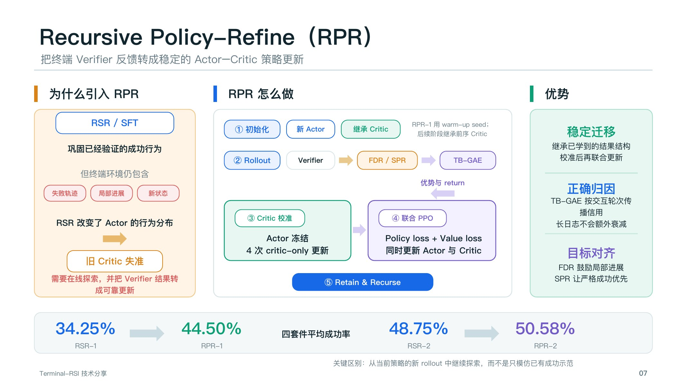
  </a>
  <figcaption>Slide 7 · RPR inherits the critic, gathers new rollout data, calibrates value estimates while freezing the actor, and then performs joint PPO updates. The next cycle starts from the retained actor–critic checkpoint.第 7 页 · RPR 继承 Critic，采集新的 rollout 数据，在冻结 Actor 时校准价值估计，随后进行联合 PPO 更新，并保留 Actor–Critic checkpoint 进入下一轮。</figcaption>
</figure>

<h2>5. Three stability problems5. 三个训练稳定性问题</h2>

Recursive training remains unstable unless three clocks agree: the interaction clock used for credit assignment, the policy distribution covered by the critic, and the reward hierarchy used to compare partial progress with strict completion.递归训练要保持稳定，需要同时对齐三件事：信用分配所依据的交互时钟、Critic 覆盖的策略分布，以及比较局部进展和严格成功的奖励层级。

<figure class="slide-figure">
  <a href="/assets/blog/terminal-rsi/slide-08-recursive-training-problems.jpg" target="_blank" rel="noopener">
    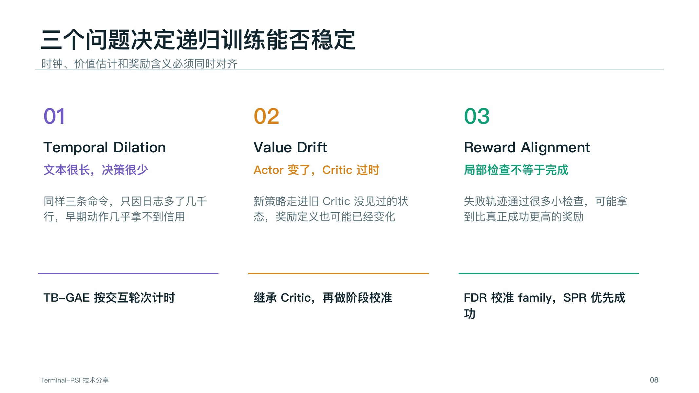
  </a>
  <figcaption>Slide 8 · Temporal Dilation, Value Drift, and Reward Alignment summarize the three failure modes addressed by TB-GAE, critic inheritance and calibration, and the FDR/SPR reward design.第 8 页 · Temporal Dilation、Value Drift 和 Reward Alignment 概括了三类失败模式，分别对应 TB-GAE、Critic 继承与校准，以及 FDR/SPR 奖励设计。</figcaption>
</figure>

<h3>Temporal DilationTemporal Dilation：长日志稀释信用</h3>

Token-level GAE treats every observation token as another recursive step. A long terminal log can therefore make early actions appear causally irrelevant. TB-GAE advances time at interaction boundaries while keeping observation text in the context.普通 token-level GAE 会把每个 observation token 都当作递归节点。长终端日志因此会让早期动作的信用接近于零。TB-GAE 只在交互轮次边界推进时间，同时仍把完整观察保留在上下文中。

<figure class="slide-figure">
  <a href="/assets/blog/terminal-rsi/slide-09-temporal-dilation.jpg" target="_blank" rel="noopener">
    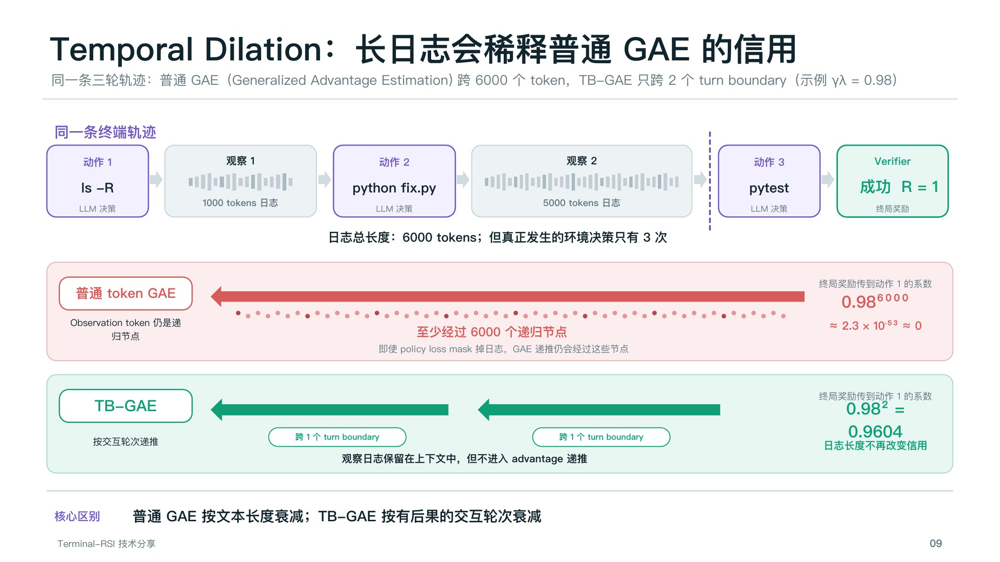
  </a>
  <figcaption>Slide 9 · Across 6,000 observation tokens, token-level discounting nearly removes credit from the first action. TB-GAE discounts across two interaction boundaries instead.第 9 页 · 当轨迹中包含 6,000 个 observation token 时，按 token 衰减几乎抹掉了第一个动作的信用；TB-GAE 改为只跨两个交互轮次边界衰减。</figcaption>
</figure>

<h3>Value DriftValue Drift：策略变化导致 Critic 失准</h3>

After RSR changes the actor, the new policy visits histories that the old critic did not cover. Resetting the critic discards useful structure, while using it unchanged introduces bias. Terminal-RSI inherits the critic and recalibrates it on the new distribution before joint optimization.RSR 改变 Actor 后，新策略会访问旧 Critic 没有覆盖的历史。重置 Critic 会丢掉已有结构，直接使用又会产生偏差。Terminal-RSI 继承旧 Critic，并在联合优化前用新分布对其进行校准。

<figure class="slide-figure">
  <a href="/assets/blog/terminal-rsi/slide-10-value-drift.jpg" target="_blank" rel="noopener">
    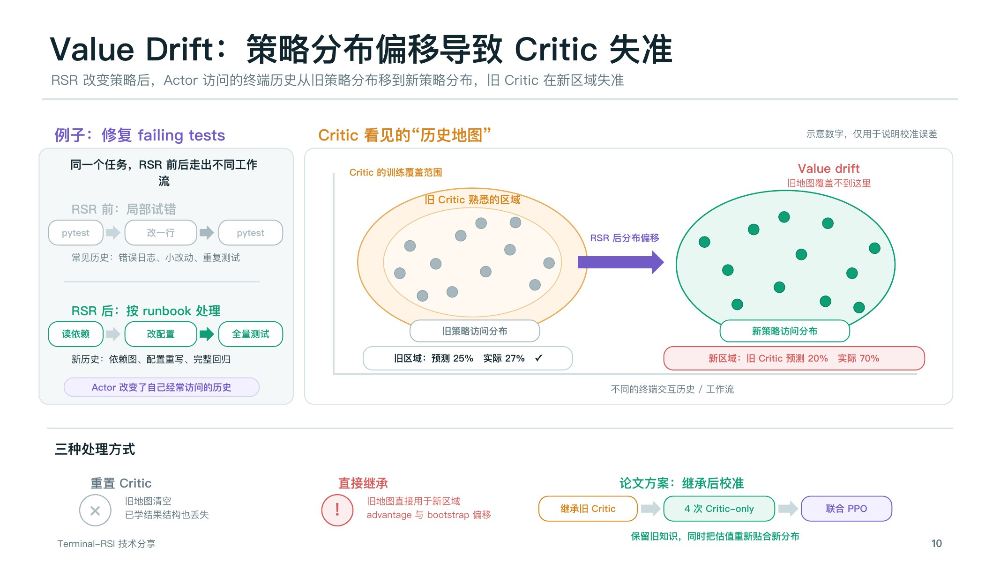
  </a>
  <figcaption>Slide 10 · Policy rewriting shifts the visited-history distribution. The proposed compromise keeps the old critic's knowledge but performs critic-only calibration on the new region.第 10 页 · 策略改写会移动访问历史的分布。论文方案保留旧 Critic 的知识，同时在新区域执行 critic-only 校准。</figcaption>
</figure>

<h3>Reward AlignmentReward Alignment：局部进展与严格成功</h3>

Different verifier families expose different numbers of checks, so raw progress counts are not comparable. Family Dense Reward normalizes progress within each family. Success-Prioritized Reward then ensures that strict task completion outranks any failed trajectory, regardless of its partial progress.不同 verifier family 的检查数量不同，原始进展数不能直接比较。Family Dense Reward 在 family 内归一化进度；Success-Prioritized Reward 再保证严格完成的轨迹一定高于任何失败轨迹，无论失败轨迹取得了多少局部进展。

<figure class="slide-figure">
  <a href="/assets/blog/terminal-rsi/slide-11-reward-alignment.jpg" target="_blank" rel="noopener">
    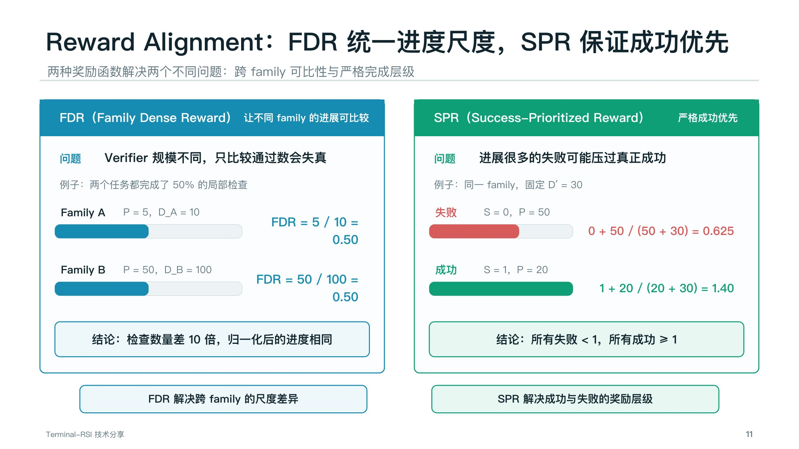
  </a>
  <figcaption>Slide 11 · FDR makes progress comparable across verifier families. SPR creates a reward hierarchy in which every successful trajectory scores above every failed trajectory.第 11 页 · FDR 解决不同 verifier family 之间的进度尺度差异；SPR 建立成功与失败的奖励层级，让所有成功轨迹都高于所有失败轨迹。</figcaption>
</figure>

<figure class="slide-figure">
  <a href="/assets/blog/terminal-rsi/slide-12-training-update.jpg" target="_blank" rel="noopener">
    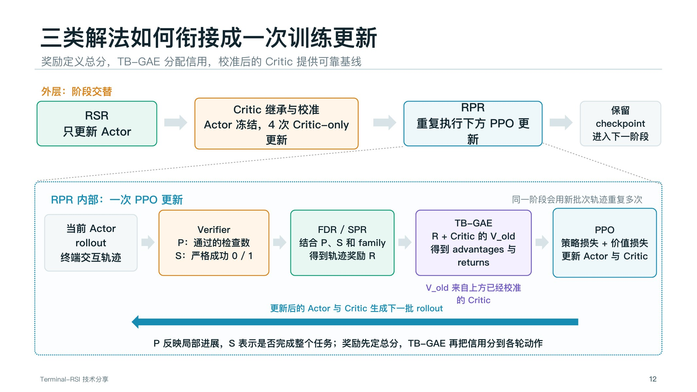
  </a>
  <figcaption>Slide 12 · In one RPR update, verifier outputs define progress and success, FDR/SPR construct rewards, TB-GAE assigns credit with the calibrated old critic, and PPO updates both actor and critic.第 12 页 · 在一次 RPR 更新中，verifier 给出进展和成功信号，FDR/SPR 构造奖励，TB-GAE 使用已校准的旧 Critic 分配信用，最后由 PPO 同时更新 Actor 与 Critic。</figcaption>
</figure>

<h2>6. Results, limitations, and practical lessons6. 结果、局限与实践启示</h2>

The reported checkpoints improve across five stages, but the paper evaluates a coupled system rather than isolated components. The results establish that the combination can work; they do not fully identify the contribution of every design choice.论文报告的 checkpoint 在五个阶段中持续提升，但实验验证的是一套耦合系统，而不是彼此独立的组件。结果说明这套组合能够奏效，却还不能完全区分每个设计选择的独立贡献。

<figure class="slide-figure">
  <a href="/assets/blog/terminal-rsi/slide-13-results.jpg" target="_blank" rel="noopener">
    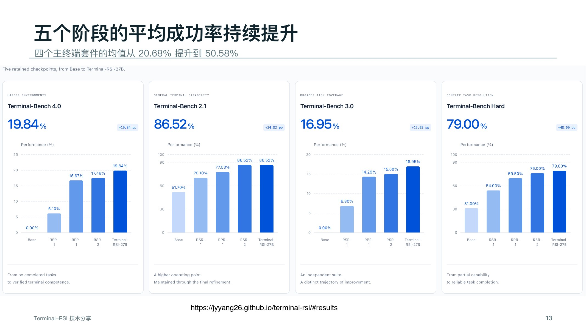
  </a>
  <figcaption>Slide 13 · Across four terminal suites, retained checkpoints improve from the base model through two RSR/RPR cycles. The four-suite mean rises from 20.68% to 50.58%.第 13 页 · 在四个终端测试集上，保留的 checkpoint 经过两轮 RSR/RPR 后持续提升，四套件平均成功率从 20.68% 提高到 50.58%。</figcaption>
</figure>

<figure class="slide-figure">
  <a href="/assets/blog/terminal-rsi/slide-14-limitations.jpg" target="_blank" rel="noopener">
    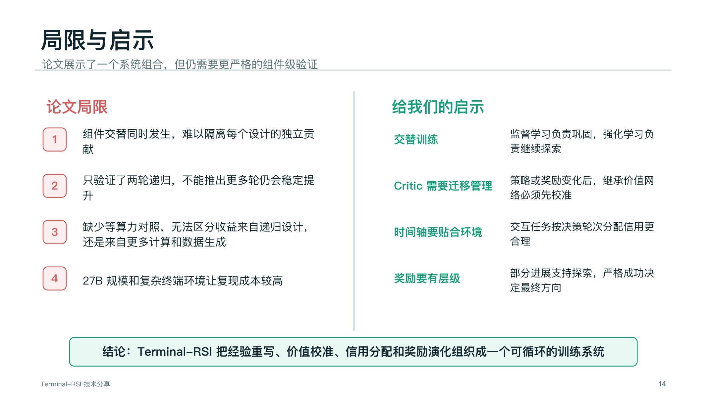
  </a>
  <figcaption>Slide 14 · The main limitations are coupled component changes, only two demonstrated recursions, missing compute-matched controls, and the cost of a 27B model in complex terminal environments.第 14 页 · 主要局限包括组件同时变化导致难以归因、只验证了两轮递归、缺少等算力对照，以及 27B 模型和复杂终端环境带来的复现成本。</figcaption>
</figure>

## My main takeaways

Terminal-RSI is valuable less as a single algorithm than as a systems design for recursive training. It separates trajectory rewriting from online policy improvement, treats critic migration as an explicit problem, aligns credit assignment with interaction time, and makes strict completion dominate partial progress.

The most useful research questions that remain are component-level: Which gains come from better data, which come from additional compute, and which require the particular RSR/RPR alternation? Answering them requires isolated ablations and compute-matched baselines.

## 我的主要理解

Terminal-RSI 的价值不只在某一个算法，而在于它给出了一套递归训练的系统设计：将轨迹改写与在线策略改进分开，把 Critic 迁移作为显式问题，让信用分配遵循环境交互时间，并确保严格完成优先于局部进展。

后续最值得研究的是组件级归因：提升究竟来自更好的数据、更多计算，还是必须依赖 RSR/RPR 的交替结构？这需要更严格的独立消融和等算力 baseline。

